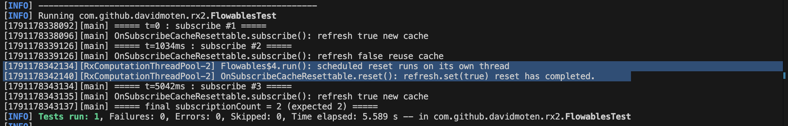

Here is my analysis for the flaky testCache() in FlowablesTest.java. 

**What does the test do?**

At a high level this test is testing flowable cache behavior with a duration of 3s. The test increments a counter when the cache is not used (a new cache is created). This happens `subscriptionCount.incrementAndGet();` in code block 1.

*CodeBlock1*: The Flaky Test

```
@Test
public void testCache() {

    final AtomicInteger subscriptionCount = new AtomicInteger(0);

    Flowable<String> source =
            Flowable.just("Alpha", "Beta", "Gamma", "Delta", "Epsilon");

    final CloseableFlowableWithReset<List<String>> closeable = Flowables.cache(
            source.doOnSubscribe(new Consumer<Subscription>() {
                                        @Override
                                        public void accept(@NonNull Subscription subscription) throws Exception {
                                            subscriptionCount.incrementAndGet();
                                        }
                                    }
            ).toList().toFlowable(), 3, TimeUnit.SECONDS, Schedulers.computation());

    Flowable<List<String>> timed = closeable.flowable().doOnNext(new Consumer<List<String>>() {
        @Override
        public void accept(@NonNull List<String> s) throws Exception {
            closeable.reset();
        }
    });

    timed.subscribe();

    try {
        Thread.sleep(1000);
    } catch (InterruptedException e) {
        e.printStackTrace();
    }

    timed.subscribe();
    try {
        Thread.sleep(4000);
    } catch (InterruptedException e) {
        e.printStackTrace();
    }

    timed.subscribe();

    assertTrue(subscriptionCount.get() == 2);
}
```

The test calls timed.subscribe() three times with a 1s delay between the first and the second call and a 4s delay between the second and third call. There is a 3s duration on the cache. The first 1s delay in the test simulates a cache hit since it is within the 3s duration. When this happens it is not a true "subscribe" (what ever is cached is used). The actual subscribe function and the cache refresh behavior is controlled in `OnSubscribeCacheResettable.java` shown in *CodeBlock2*. Notice the if block where a new cache is created. 

*CodeBlock2*
```
public OnSubscribeCacheResettable(Flowable<T> source) {
    this.source = source;
    this.current = source;
}

public void subscribe(final Subscriber<? super T> subscriber) {
    if (refresh.compareAndSet(true, false)) {
        current = source.cache();
    }
    current.subscribe(subscriber);
}

public void reset() {
    refresh.set(true);
}
```

The second subscribe doesn't increase the subscriptionCount in the test. 
The 4 second delay after this is longer than the 3s cache duration. Therefore on the third subscribe the counter increments successfully. 

What I describe above is a passing run. I added some logs printing exact timestamps when I run this locally. 


The fact that reset is on it's own thread, and we rely on a sleep() to wait for the completion of the thread is what makes this particular test flaky. It is not guaranteed that reset will have completed in the 4s delay between the second and third subscribe. The thread may not be alloted time in that window, and may fail to complete. This can cause the third subscribe to also use the cache and not increment the subscription counter. 

In the failing case the test fails with supscription count 1.


