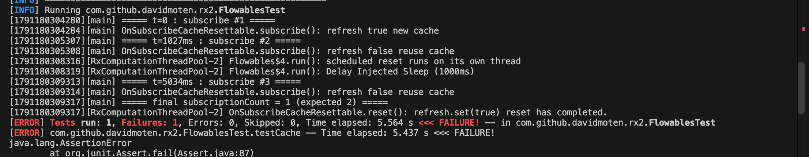

Here is my analysis of the flaky testCache() in FlowablesTest.java. 

**What does the test do?**

At a high level, this test is testing flowable cache behavior with a duration of 3s. The test increments a counter when the cache is not used (a new cache is created). This happens at `subscriptionCount.incrementAndGet();` in *CodeBlock1*.

*CodeBlock1*: The Flaky Test

```
@Test
public void testCache() {

    final AtomicInteger subscriptionCount = new AtomicInteger(0);

    Flowable<String> source =
            Flowable.just("Alpha", "Beta", "Gamma", "Delta", "Epsilon");

    final CloseableFlowableWithReset<List<String>> closeable = Flowables.cache(
            source.doOnSubscribe(new Consumer<Subscription>() {
                                        @Override
                                        public void accept(@NonNull Subscription subscription) throws Exception {
                                            subscriptionCount.incrementAndGet();
                                        }
                                    }
            ).toList().toFlowable(), 3, TimeUnit.SECONDS, Schedulers.computation());

    Flowable<List<String>> timed = closeable.flowable().doOnNext(new Consumer<List<String>>() {
        @Override
        public void accept(@NonNull List<String> s) throws Exception {
            closeable.reset();
        }
    });

    timed.subscribe();

    try {
        Thread.sleep(1000);
    } catch (InterruptedException e) {
        e.printStackTrace();
    }

    timed.subscribe();
    try {
        Thread.sleep(4000);
    } catch (InterruptedException e) {
        e.printStackTrace();
    }

    timed.subscribe();

    assertTrue(subscriptionCount.get() == 2);
}
```

The test calls timed.subscribe() three times, with a 1s delay between the first and the second call and a 4s delay between the second and the third call. There is a 3s duration on the cache. The first 1s delay in the test simulates a cache hit since it is within the 3s duration. When this happens, it is not a true "subscribe" (whatever is cached is used). The actual subscribe function and the cache refresh behavior are controlled in `OnSubscribeCacheResettable.java`, shown in *CodeBlock2*. Notice the if block where a new cache is created. 

*CodeBlock2*
```
public OnSubscribeCacheResettable(Flowable<T> source) {
    this.source = source;
    this.current = source;
}

public void subscribe(final Subscriber<? super T> subscriber) {
    if (refresh.compareAndSet(true, false)) {
        current = source.cache();
    }
    current.subscribe(subscriber);
}

public void reset() {
    refresh.set(true);
}
```

The second subscribe doesn't increase the subscriptionCount in the test. 
The 4-second delay after this is longer than the 3s cache duration. Therefore, on the third subscribe, the counter increments successfully. 
I added some logs that print exact timestamps and thread names when I ran this locally. 


**What makes this test flaky?**

The fact that reset is on its own thread, and we rely on a sleep() to wait for the completion of the thread, is what makes this particular test flaky. It is not guaranteed that reset will have completed in the 4s delay between the second and third subscribe calls. The thread may not always be allotted time in that window, and may fail to complete. When the test fails, the third subscribe uses the cache and subscriptionCount is not incremented. The test fails with a subscriptionCount of 1.

In order to produce the failing behavior, I added a delay of 1000ms in the function that is responsible for the cache reset. [Exact diff for the change in test code](https://github.com/nishandhkr/rxjava2-extras/commit/f7368d9a64cd293fc26c1962c5fbaf9b2525079b#diff-1280ed9414e191ce0aeaee536652afb4f3701ff94723810604939678e76e9cae). The figure below shows the failing run.




